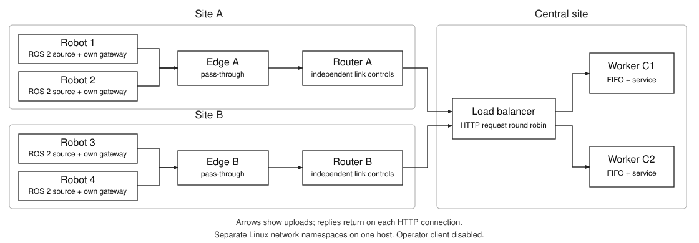

# ROS 2 / REST multi-site experiment kit

This is a self-contained starting network for the project partner. It runs four
independent robot clients, two site edges, two routers, a central HTTP load
balancer and two central worker processes. Each robot has its own ROS 2 source,
gateway, FIFO and HTTP connection. It is separate from the completed E1 and E2
code and datasets.



This is a real Linux/ROS/HTTP execution on one machine, with isolated network
namespaces representing hosts. It is not four physical robots or computers.
Every robot process contains two ROS nodes: one source and one gateway. ROS
traffic stays local to that robot namespace; HTTP crosses the routed network.

## First run

Target: Ubuntu 22.04 with ROS 2 Humble, either native Linux or WSL2. Use the Linux
filesystem (for example `~/partner_network`), not a Google Drive mount. Extract
the complete ZIP; no files from James's existing project are required.

If ROS is not installed, follow the official
[Humble Ubuntu installation instructions](https://docs.ros.org/en/humble/Installation/Ubuntu-Install-Debs.html)
([official source mirror](https://github.com/ros2/ros2_documentation/blob/humble/source/Installation/Ubuntu-Install-Debs.rst)).
Once its apt repository is configured, the required runtime packages are:

```bash
sudo apt update
sudo apt install ros-humble-ros-base ros-humble-rclpy ros-humble-std-msgs iproute2 iputils-ping tcpdump ethtool
```

The kit uses Python's standard library plus the ROS packages; it needs no pip
packages, Docker image or colcon build. From the extracted kit directory:

```bash
bash run.sh doctor
python3 -B -m unittest discover -s tests -v
sudo bash run.sh run --config configs/full_reference.json --warmup 2 --duration 5 --drain 8 --output runs/first_smoke
```

Use a **new output directory** every time. The command starts the topology,
checks node readiness and routes, captures traffic, runs the workload, drains,
cleans up and independently checks message/queue accounting. See
`VALIDATION.md` for the checks actually performed on the delivered version.

A normal one-minute measurement is:

```bash
sudo bash run.sh run --config configs/full_reference.json --output runs/full_reference_r01
```

Default timing is 10 s warm-up, 60 s measurement and up to 30 s drain. Startup,
route calibration and shutdown add wall time. Root is needed to create the
isolated network; the harness does not alter the primary interface, host routes,
host forwarding or global TCP congestion-control setting.

## Three application topologies

| Configuration | Running application path | Purpose |
|---|---|---|
| `direct.json` | 4 independent clients → 1 worker | Distributed-client reference, T1 |
| `central_pool_1/2/4.json` | 4 clients → proxy → 1/2/4 workers | Central pool, T2 |
| `full_reference.json` | 4 clients → 2 pass-through edges → proxy → 2 workers | Two-site reference, T3 |

All variants use the same routed three-LAN network. Unused edge/proxy namespaces
may remain as empty hosts in simpler variants; `active_components` records which
applications actually ran. Each server is a separate process and namespace. The
proxy balances **requests** round robin; it is not an IP router. Each worker has
its own FIFO and one service thread by default. This is not a common-queue M/M/m
implementation.

## Change one factor

| Preset | Deliberate change |
|---|---|
| `site_a_delay.json` | Site A: 20 ms forward + 20 ms reverse added delay |
| `site_a_capacity.json` | Site A: 2 Mbit/s forward link |
| `site_a_loss.json` | Site A: 1% forward packet-loss probability |
| `site_a_outage.json` | Site A: both directions suppressed from measurement seconds 10–20 |
| `server_limited_1/2/4.json` | Worker count with the same 20 ms controlled service hold |
| `tcp_cubic.json`, `tcp_reno.json` | Robot sender TCP sockets: Cubic versus Reno, with the remaining settings fixed |

Profiles use Linux `netem` on the owned site routers. Forward means router WAN
egress towards the central LAN; reverse means router LAN egress towards its
robots/edge. Site B remains unchanged in site-A-only presets. A 20 ms setting
in each direction adds roughly 40 ms to ping RTT, plus implementation overhead;
inspect `ping_calibration.json` and qdisc counters rather than treating a
configured number as a measured result. Rate/delay accuracy depends on the host
and kernel ([netem documentation](https://www.man7.org/linux/man-pages/man8/tc-netem.8.html)).

`extends` merges JSON dictionaries; arrays replace the parent array. Copy a
preset to add your own variant. Edit `robots` to change actual client count,
`workers` for central processes, `traffic` for per-client rates/sizes, and
`sites` for independent uplink controls. Record all changes in the saved config.

## What traffic means

Each source produces command/status/odometry/sensor traffic at 2/5/20/5 Hz with
100/100/250/20,000 useful payload bytes. Four sources therefore offer 128 original
messages/s. Streams have seeded periodic phases and keep publishing while HTTP
requests wait. The `command` class is an **uplink synthetic critical event**;
this kit does not actuate robots or implement downlink commands.

Each robot has one persistent HTTP/1.1 connection and one outstanding request.
Edges forward responses only after the central worker processes the original
message. A response timeout may occur after processing; the logs retain that
ambiguity. Application retries are off. TCP retransmission remains active when
packets are lost. Useful payload bytes, HTTP-body bytes and packet bytes are
different measurements.

## Results to inspect

- `summary.json`: aggregate and per-robot results, class outcomes, worker counts,
  goodput, latency and queue occupancy.
- `per_robot_class.csv`: every robot/class, including losses and deadline misses.
- `validation.json`: independent accounting checks; inspect any failures.
- `logs/robot*/source.jsonl`, `gateway.jsonl`, `queue.jsonl`: message IDs,
  scheduling, queue states and terminal outcomes.
- `logs/worker*/worker.jsonl`: actual central processing and worker identities.
- `logs/edge*/hops.jsonl`, `logs/proxy/hops.jsonl`: forwarding and backend choices.
- `logs/*/connections.jsonl`: actual socket endpoints, reuse and TCP algorithms.
- `network/siteA_wan.pcap`, `siteB_wan.pcap`: open in Wireshark on either OS.
- `network/topology.json`, `resolved.json`, `readiness.json`, `code_snapshot.zip`:
  actual addresses, launched components, ROS nodes and exact code/configuration.

The captures cover the two routed site uplinks, not the local robot-to-edge or
proxy-to-worker links. Start Wireshark with `http` or `tcp.port == 8080`; use
Decode As → HTTP if needed, then Follow TCP Stream. Inspect
`tcp.analysis.retransmission` and connection handshakes for transport evidence.
Capture metadata checks do not replace a full request-by-request reconstruction.
The harness records virtual-interface offload settings and attempts to disable
TSO/GSO/GRO when `ethtool` is installed. Inspect the recorded `offloads` status:
without verified disabling, captured virtual packets may exceed the link MTU
and cannot be counted as physical wire frames. The delivered smoke tests ran
without `ethtool`; their captures still support application-stream inspection.

`example_run/` contains one completed short full-topology run, including raw
logs and both Wireshark captures. It is a functional example, not a performance
experiment. Its saved addresses and process IDs describe that historical run.
Inspect it without starting any network:

```bash
python3 -B -m lab.runner analyze example_run
```

## Recovery and extension

Normal completion removes owned interfaces and namespaces. If a run is
interrupted, inspect its process status, then recover using its journal:

```bash
bash run.sh status runs/first_smoke
sudo bash run.sh cleanup runs/first_smoke
```

Cleanup checks recorded process identities and resource ownership. It refuses
to delete a namespace occupied by an unrecognised process; inspect the recorded
reason instead of deleting namespaces by a broad name pattern.

Start your work with [HANDOVER.md](HANDOVER.md), then read the
[experiment suggestions](docs/EXPERIMENTS.md) and [metric definitions](docs/METRICS.md).
This starter implements HTTP/1.1, FIFO, pass-through edges and round robin.
HTTP/2/3, application retransmission/deduplication, deadline-aware scheduling,
edge filtering, adaptive coordination, persistent recovery and an operator
client are explicit extension tasks. Supplying this network does not complete
those experiments or make its measurements interchangeable with E1/E2.
