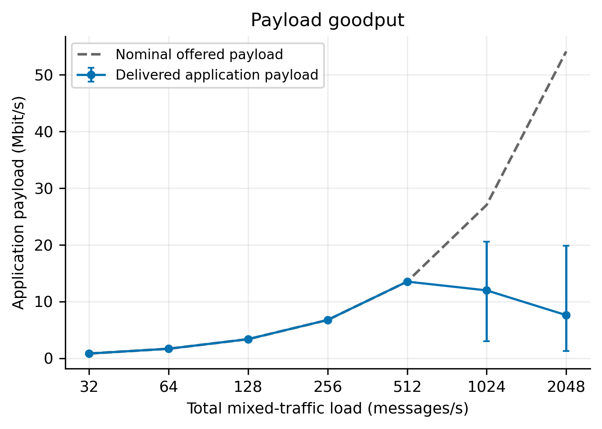
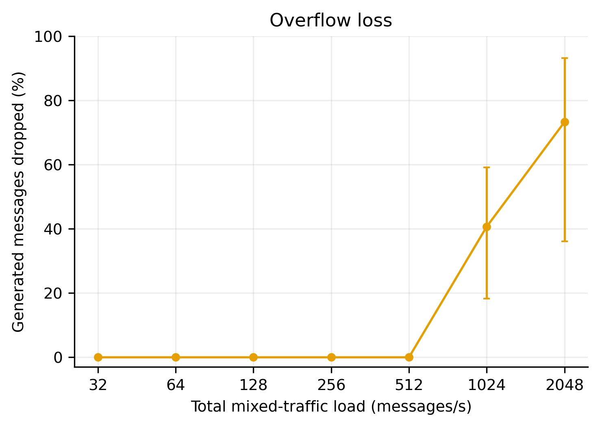
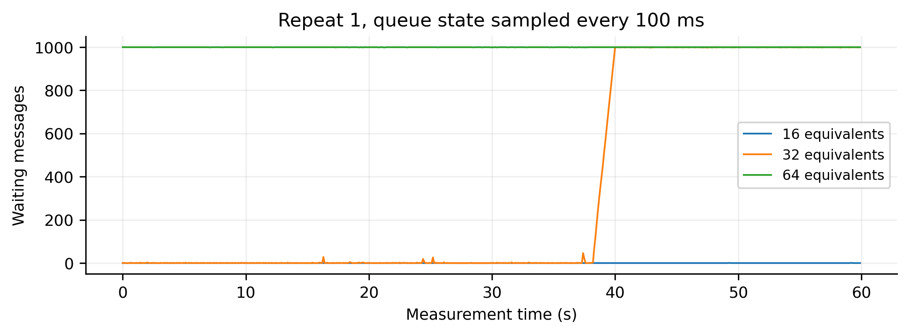

# E1: suggested results narrative

Use this order: experimental procedure, throughput, queue occupancy, latency, deadline failures, CPU consumption, occupied time, and limitations. It first establishes whether the gateway keeps up, then shows the backlog and its consequences, and finally examines resource use. File numbers are identifiers; let LaTeX number figures in their order of appearance.

All plots below are derived from the same completed E1 dataset. They are not separate experiments. The six main plots belong in the main narrative if space permits. The remaining five plots provide supporting appendix evidence. Do not mix the earlier single-topic pilot results into this section.

For each plot, put the measurement paragraph before the figure, its caption immediately beneath it, and the interpretation paragraph after the caption. The text below can be adapted directly into the report. The labels “Before the figure” and “Interpretation” are writing guidance and need not appear in the submitted report.

## 1. Experimental objective and procedure

### Suggested report text

E1 evaluated how a ROS2-to-REST gateway responds to increasing mixed traffic under a clean network condition. The objective was to identify conditions under which the baseline completes the offered traffic, and conditions under which queueing, dropped messages and missed deadlines emerge. The gateway used FIFO scheduling, a capacity of 1,000 waiting messages, one persistent HTTP/1.1 connection and one outstanding request to one REST server. Messages arriving when the FIFO was full were dropped. No application retries or network impairments were injected. Generator, gateway and server ran on the same Ubuntu 22.04 WSL2 host, with HTTP using loopback.

The workload comprised four periodic traffic classes. Each robot-equivalent generated the rates shown below, giving 32 messages/s in total. The payload sizes are application data sizes; JSON metadata and protocol headers add further bytes.

| Traffic class | Base rate per equivalent | Base interval | Payload | Deadline target |
|---|---:|---:|---:|---:|
| Command | 2 messages/s | 500 ms | 100 B | 100 ms |
| Status | 5 messages/s | 200 ms | 100 B | 200 ms |
| Odometry | 20 messages/s | 50 ms | 250 B | 100 ms |
| Sensor | 5 messages/s | 200 ms | 20,000 B | 1,000 ms |

The tested loads were 1, 2, 4, 8, 16, 32 and 64 robot-equivalents, corresponding to nominal totals of 32, 64, 128, 256, 512, 1,024 and 2,048 messages/s. One ROS2 robot node was used at the lowest load and two at all other loads. For a load of N equivalents with N at least two, each node published at N/2 times the base rates. Thus, four equivalents generated 80 odometry messages/s using two nodes at 40 messages/s each. These conditions represent increasing traffic volume rather than increasing numbers of independent ROS2 nodes or HTTP clients.

Each robot/class stream had a seeded initial offset and then published periodically. The scheduler published whichever stream was due next. The gateway served admitted messages in its queue-arrival order, without class priority, and waited for one HTTP response before sending the next request. Traffic generation continued independently of response completion. The three repetitions used different reproducible initial phases, and the 21-run execution order was shuffled.

Each load was tested three times with a five-second warm-up, a 60-second measurement window and up to 15 seconds to drain outstanding work. Every generated message had an identifier, with timestamps recorded for each stage it reached: generation, gateway admission, dequeue, server receipt and response completion. The main latency measure was generation-to-response completion, including ROS2 delivery, queue waiting, request serialisation and the HTTP exchange. It was not a measurement of network transit time alone.

Successful-message latency used messages generated inside the measurement window, including successful responses received during the drain. Deadline-failure ratios included all messages generated in that window, including messages that never completed. Throughput and goodput counted responses completed inside the measurement window. These populations differ at the window boundaries. The four deadline targets were illustrative project choices fixed before the sweep, rather than externally prescribed safety limits.

For the load-sweep plots, each run first produced one statistic at each load. Points show the arithmetic mean of the three run-level statistics, while error bars extend from the smallest to the largest. In particular, a latency point is the mean of three separately calculated p95 values; it is not the p95 of pooled messages. Error bars describe observed repeat variation, not confidence intervals. Queue traces and within-run appendix plots use the separate procedures stated below.

The sweep accounted for 731,504 generated messages: 386,438 successful completions and 345,066 FIFO admission drops. There were no missing ROS2 messages, HTTP request errors or messages pending after the drain. A separate five-minute two-robot run validated topic rates and persistent HTTP communication; it was not included as an additional load-sweep repetition.

## 2. Can the gateway keep up? Completed throughput

**Before the figure — how it was produced:** Successful responses completed during each 60-second measurement window were counted and divided by the window duration to obtain completed requests/s. The horizontal coordinate is the measured total generation rate across all four traffic classes. Each point averages the three throughput measurements at that load, with minimum–maximum error bars. The dashed line represents completion rate equal to generation rate.

**Caption:** Completed request throughput versus total mixed-traffic load. The dashed reference denotes completion rate equal to offered rate. Points are means of three runs; error bars show minimum–maximum. The horizontal axis uses a logarithmic scale. [Vector PDF](../results/e1_complete/figures/fig4_throughput.pdf)

**Interpretation:** Up to 16 equivalents, mean completion rate closely followed offered traffic. At the nominal load of 512 messages/s, completed throughput averaged 512.1 requests/s; the small excess reflects measurement-window boundary effects. At 32 and 64 equivalents, completion rates averaged 601.8 and 547.5 requests/s despite nominal offered rates of 1,024 and 2,048 messages/s. This shortfall demonstrates that the measured path could not keep up under those conditions. The high-load error bars are substantial, so the lower mean at 64 equivalents should not be interpreted as a smooth, stable capacity curve. Across its three repetitions, throughput ranged from 139.12 to 1,309.05 requests/s.

## 3. Where does the unfinished work accumulate? Queue occupancy

**Before the figure — how it was produced:** The gateway logged its waiting-queue length whenever queue state was recorded during admission or sending. Mean occupancy was calculated by weighting each queue length by the time for which it persisted, integrating over the measurement window and dividing by 60 seconds. The request already being sent was excluded. The plotted point is the mean of the three run-level time averages, with minimum–maximum error bars.

**Caption:** Time-averaged FIFO occupancy versus total mixed-traffic load. The dashed line marks the capacity of 1,000 waiting messages. Points are means of three runs; error bars show minimum–maximum. Both axes use logarithmic scales. [Vector PDF](../results/e1_complete/figures/fig3_queue.pdf)

**Interpretation:** Mean queue occupancy was only 0.65 messages at 16 equivalents, but rose to 782.67 at 32 equivalents and 999.69 at 64 equivalents. The highest-load queue therefore remained close to its configured capacity. Because the FIFO is bounded, further overload produces admission drops rather than unlimited queue growth. The sweep discarded 40.68% and 73.27% of generated messages at 32 and 64 equivalents, respectively, when counts were combined across repetitions. Together with the throughput shortfall, this supports interpreting the high-load conditions as queue overload.

## 4. What delay does each class experience? Successful-message latency

**Before the figure — how it was produced:** For each successful message generated during measurement, the source timestamp was subtracted from the timestamp at which the gateway finished receiving and parsing the server response. Successful responses during the bounded drain were included. Messages were grouped by traffic class, and each run's p95 was calculated separately. A plotted point is the mean of that class's three run-level p95 values, with the lowest and highest forming its error bar. The bottom axis denotes robot-equivalent load N; the top axis denotes the nominal combined workload of 32N messages/s. A green point at N=1 measures odometry delay with 20 odometry messages/s sharing the path with 12 messages/s from the other classes.

**Caption:** Successful-message p95 source-to-response latency by traffic class. Every curve is measured under the same mixed workload at each horizontal position. Points are means of three run-level p95 values; error bars show minimum–maximum. Load and latency use logarithmic scales. [Vector PDF](../results/e1_complete/figures/fig1_latency.pdf)

**Interpretation:** Mean run-level p95 latency remained below 8 ms for each class across the 1–16-equivalent conditions. At 32 equivalents, the class-specific means were approximately 2.3 s, rising to approximately 4.7 s at 64 equivalents. For example, odometry p95 increased from 4.10 ms at 16 equivalents to 2,334.07 ms at 32 equivalents and 4,691.65 ms at 64 equivalents. This increase coincides with the queue accumulation shown above. The similar class delays under overload are consistent with sharing a FIFO that gives no priority to commands or odometry. The plot includes successful messages only, so it must be interpreted alongside drops and deadline failures; it does not establish acceptable delivery for the entire generated workload.

## 5. Are responses useful in time? Deadline failures

**Before the figure — how it was produced:** Each generated message was compared with its class's fixed generation-to-response deadline. A failure was either a successful response later than the target or an unsuccessful message, including FIFO drops. For each class and run, the number of failures was divided by all messages of that class generated during measurement and multiplied by 100. Each point averages the three run-level percentages, with minimum–maximum error bars. The workload axes have the same meaning as in the latency figure.

**Caption:** Deadline-failure percentages including late and unsuccessful messages. Targets are command 100 ms, status 200 ms, odometry 100 ms and sensor 1,000 ms. Points are means of three run-level percentages; error bars show minimum–maximum. [Vector PDF](../results/e1_complete/figures/fig2_deadlines.pdf)

**Interpretation:** No deadline failures were observed at 1–16 equivalents. At 32 equivalents, approximately 78% of each class failed its target. At 64 equivalents, all generated command, status and odometry messages failed their targets, while the sensor failure percentage averaged approximately 88.5%. Thus, successful HTTP completion alone does not imply timely communication under overload. The smaller sensor failure percentage should not be read as evidence that FIFO prioritised sensor traffic: sensor messages had a looser 1,000 ms deadline, and the traffic classes also experienced different delivery outcomes. These results motivate a later controlled comparison of FIFO and priority scheduling; they do not themselves show how much priority would improve performance.

## 6. Which processes consume CPU? CPU consumption

**Before the figure — how it was produced:** Cumulative Linux process CPU counters were sampled every 0.2 seconds for the source, gateway and server. Counters were interpolated at the exact measurement-window boundaries. For each process, the increase in CPU seconds was divided by 60 seconds and multiplied by 100. This normalises 100% to one logical CPU, so a multithreaded process can exceed 100%. Points and error bars summarise the three run-level measurements at each load.

**Caption:** Process CPU consumption versus total mixed-traffic load, normalised to one logical CPU. Points are means of three runs; error bars show minimum–maximum. CPU consumption is distinct from the occupied wall-time fractions in the following figure. [Vector PDF](../results/e1_complete/figures/fig5_cpu.pdf)

**Interpretation:** At 64 equivalents, mean gateway CPU consumption was 114.2% of one logical CPU, compared with 57.8% for the source and 14.7% for the server. The gateway therefore consumed substantially more CPU time than the server at this load. This supports examining the gateway/client processing path when investigating the bottleneck, but it does not establish that a particular core, the whole machine or the server was fully utilised. The non-monotonic server values and wide repeat ranges should be considered alongside the observed execution variability.

## 7. Where is time spent waiting or working? Occupied time

**Before the figure — how it was produced:** Gateway-sender activity intervals were measured from dequeue until response completion. Server-handler intervals were measured from entry to the POST handler until completion of the response write; they included body-read waiting but excluded HTTP header parsing and idle time before a handler started. Each interval was clipped to the measurement window. Its total occupied duration was divided by 60 seconds and multiplied by 100. These percentages include time waiting as well as executing, and therefore differ from CPU percentages. Points average three runs and error bars show their minimum and maximum.

**Caption:** Gateway-sender and server POST-handler occupied fractions versus total mixed-traffic load. The two measures have the timing boundaries defined in the text. Points are means of three runs; error bars show minimum–maximum. [Vector PDF](../results/e1_complete/figures/fig6_busy_time.pdf)

**Interpretation:** At 64 equivalents, the sender was occupied for 99.5% of the measurement interval, while the server POST handler was occupied for 39.3%. The sender therefore had almost no idle time even though the server handler was active for a smaller fraction of the interval. Separately, averaging the per-run mean delays of successful messages gave 4,175.88 ms of queue waiting and 3.98 ms from dequeue to response completion, including request serialisation and the HTTP exchange. These values show that waiting in the gateway queue dominated completed-message delay. Together, the observations implicate the serial gateway/client path rather than establishing exhausted server or physical-link capacity. Since the baseline allows only one outstanding request, adding server workers alone cannot be assumed to improve it.

## 8. Limitations and outcome of E1

### Suggested report text

The highest tested load without FIFO drops or deadline failures in any repetition was 16 robot-equivalents. Every 32- and 64-equivalent run overflowed the queue, making the 64-equivalent condition useful as an overload stress configuration. However, these observations do not establish a single stable service-capacity limit. At 64 equivalents, run-level p95 latency across all successful traffic ranged from 851.40 to 7,649.29 ms, while completed throughput ranged from 139.12 to 1,309.05 requests/s. A change within the 32-equivalent, repeat-1 run is documented in the appendix. Repeat labels identify seeded repetitions, not chronological execution order. All runs were retained, and the measurements do not establish the cause of the variability.

The results describe rate-scaled synthetic traffic on a shared WSL2 loopback host. They should not be generalised directly to independent physical robots, a separate physical network or an M/M/1 model. E1 supplies a reproducible implementation, measurement procedure and candidate reference/stress conditions for subsequent experiments. Later comparisons should recheck the reference condition and account for execution variability before attributing differences to protocol, queue policy or server count.

## Supporting appendix plots: how each was produced

The following plots are optional supporting figures. Include the two within-run plots when discussing variability. Goodput is an E1 metric and should remain reported in the summary table even if its plot is placed in the appendix.

### Application payload goodput

**Before the figure:** Configured application payload bytes were summed for messages whose successful responses completed inside the measurement window. The byte sum was multiplied by eight and divided by 60 seconds and one million to obtain Mbit/s. JSON metadata and HTTP/TCP/IP headers were excluded. Points are means of three runs; error bars show minimum–maximum. The nominal offered-payload line uses the fixed class rates and payload sizes.

**Caption:** Delivered application payload goodput and nominal offered-payload rate versus total mixed-traffic load. Points are means of three runs; error bars show minimum–maximum. [Vector PDF](../results/e1_complete/figures/appendix_goodput.pdf)

**Interpretation:** At 16 equivalents, delivered payload goodput was approximately 13.53 Mbit/s, matching the nominal offered payload rate. At 64 equivalents, it averaged 7.62 Mbit/s despite a nominal offered rate of 54.12 Mbit/s. This measures useful application data rather than physical wire throughput. Because message sizes differ and overflow can change the delivered traffic mix, requests/s and payload Mbit/s are complementary measures.

### FIFO admission drops

**Before the figure:** For each run, FIFO admission drops among messages generated during measurement were divided by the total generated-message count. The resulting percentages were averaged across three runs, with minimum–maximum error bars. This differs from the summary table's pooled-count calculation, although the reported high-load percentages round to the same values.

**Caption:** Fraction of generated messages discarded at FIFO admission versus total mixed-traffic load. Points are means of three run-level percentages; error bars show minimum–maximum. [Vector PDF](../results/e1_complete/figures/appendix_drops.pdf)

**Interpretation:** No FIFO drops occurred through 16 equivalents. The mean per-run drop fraction reached 40.68% at 32 equivalents and 73.27% at 64 equivalents. These are application queue-admission losses: dropped messages were not sent as HTTP requests. They should not be described as measured TCP packet loss.

### Queue traces

**Before the figure:** Waiting-queue state was reconstructed from timestamped queue events and sampled every 100 ms through the measurement window. The figure uses repeat 1 at 16, 32 and 64 equivalents. These are three selected time traces, not averages across repetitions, and their curves identify load conditions rather than traffic classes.

**Caption:** Waiting-queue occupancy sampled every 100 ms during repeat 1 of the three highest load conditions. The fixed repeat selection is not intended to represent every repetition. [Vector PDF](../results/e1_complete/figures/appendix_queue_trace.pdf)

**Interpretation:** Use these traces to show when backlog accumulates within a run, which a single mean occupancy cannot reveal. Conclusions about all repetitions should come from the load-sweep statistics rather than these selected traces alone.

### CPU variation within one run

**Before the figure:** The 32-equivalent, repeat-1 run was divided into consecutive 10-second bins. Cumulative CPU counters were interpolated at each bin boundary, and CPU-time increments were divided by bin duration. Lines connect bin averages for the source, gateway and server. This is one run, with no across-run error bars; repeat 1 is its seeded label rather than a claim about chronological execution order.

**Caption:** Process CPU consumption in consecutive 10-second bins of the 32-equivalent, repeat-1 run. CPU consumption is normalised to one logical CPU; lines connect bin averages. [Vector PDF](../results/e1_complete/figures/appendix_within_run_cpu.pdf)

**Interpretation:** Gateway CPU consumption increased from approximately 77–80% during the first 30 seconds to approximately 107% during the final 20 seconds, despite unchanged configured traffic rates. Source CPU consumption also increased. This shows that a whole-run average hides a change in execution behaviour; the measurements do not establish its cause.

### Queue variation within the same run

**Before the figure:** Queue occupancy was integrated separately within the same 10-second bins and divided by bin duration. Queue-state intervals were clipped at bin boundaries. These bar heights are within-run time averages, not averages of three repetitions. The analysis checks that duration-weighted bin means reproduce the validated whole-window CPU and queue statistics.

**Caption:** Time-averaged FIFO occupancy in consecutive 10-second bins of the same 32-equivalent, repeat-1 run. The dashed line marks the 1,000-message capacity. [Vector PDF](../results/e1_complete/figures/appendix_within_run_queue.pdf)

**Interpretation:** Mean occupancy was approximately one waiting message in each of the first three bins, increased to 92.82 in the 30–40 second bin, and reached approximately 999.6 in the final two bins. Queue growth coincided with the CPU changes, supporting the decision to report the variability prominently. Coincidence alone does not establish which host, scheduling or implementation effect caused the change.

## Evidence sources

These paragraphs use the completed E1 dataset and its implementation:

- [Frozen E1 procedure](../experiments/E1_PROTOCOL.md)
- [Run-level summary table](../results/e1_complete/summary_table.csv)
- [Per-class summaries](../results/e1_complete/class_deadlines.csv)
- [All individual runs](../results/e1_complete/individual_runs.csv)
- [Within-run variability analysis](../results/e1_complete/variability_note.md)
- [Report/figure calculation script](../experiments/report_e1.py)
- [Measurement code](../experiments/baseline.py)
- [CPU and deadline calculations](../experiments/metrics.py)

The per-class CSV pools counts for its deadline percentages, whereas the corresponding plot averages the three run-level percentages. Values quoted above use a precision at which this distinction does not change the displayed number. No new performance experiments were run to prepare this narrative.
