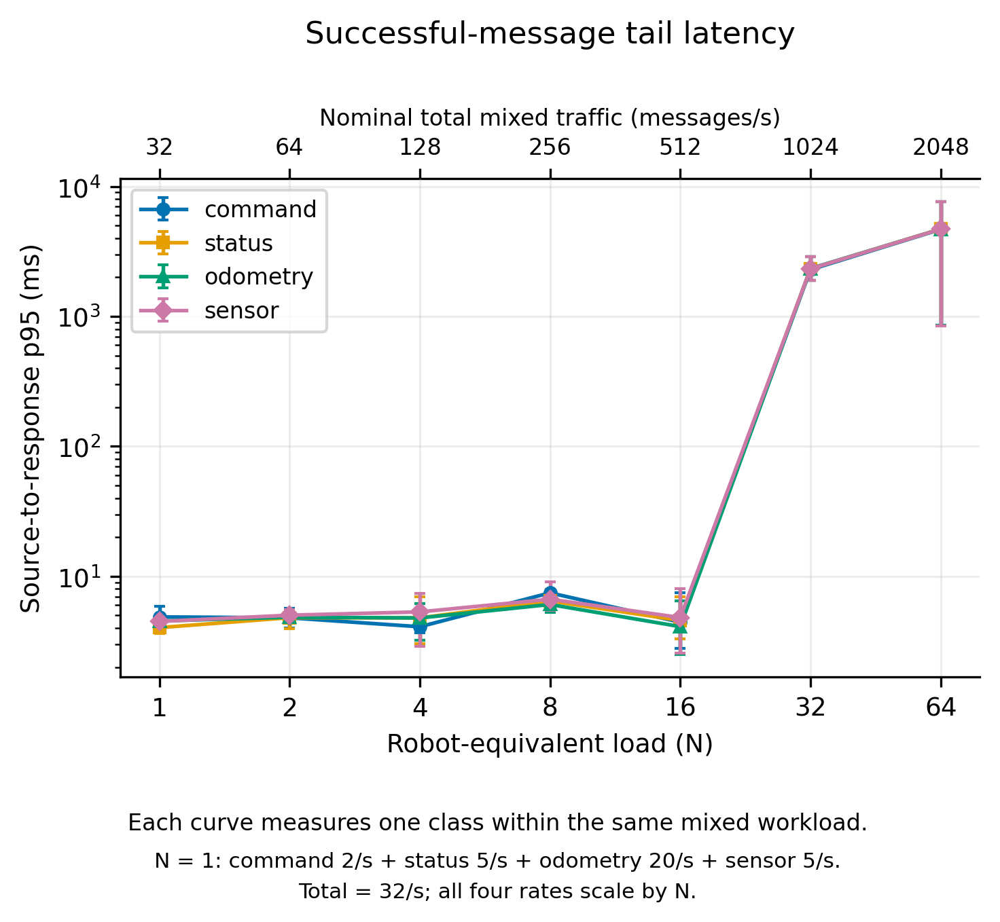
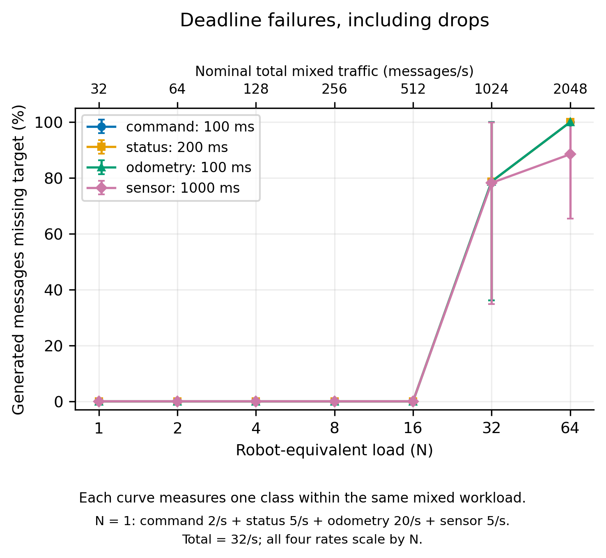
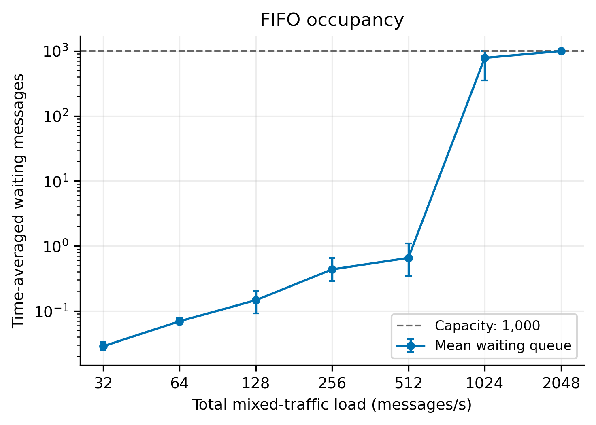
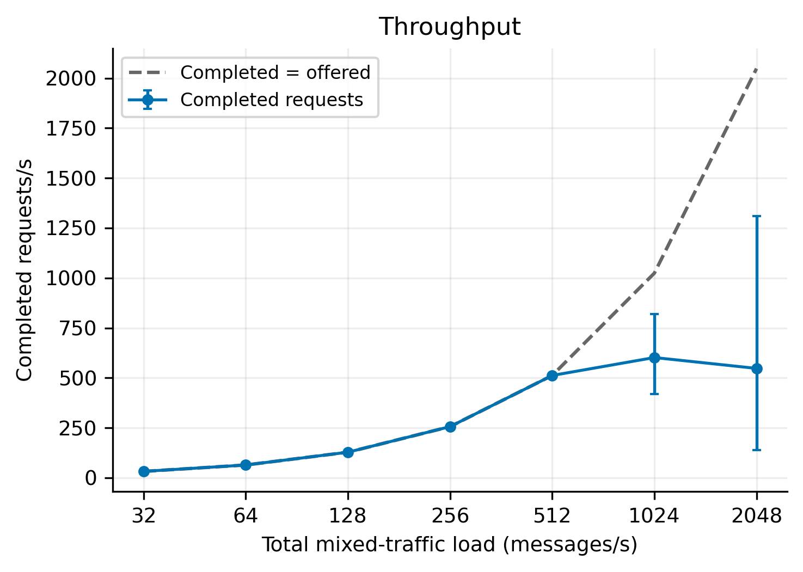
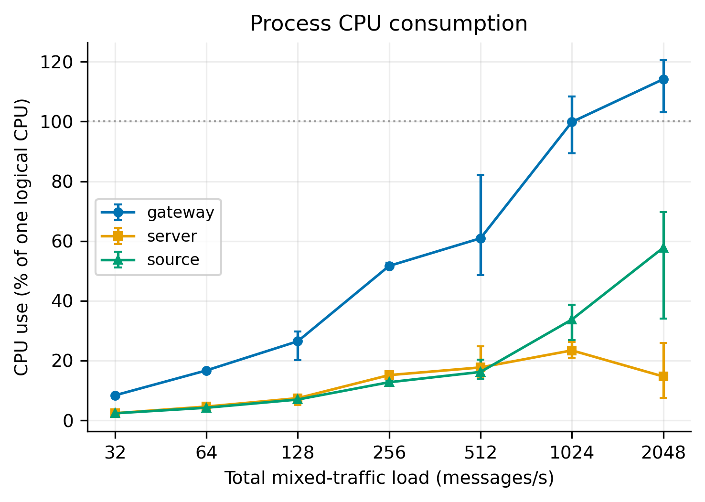
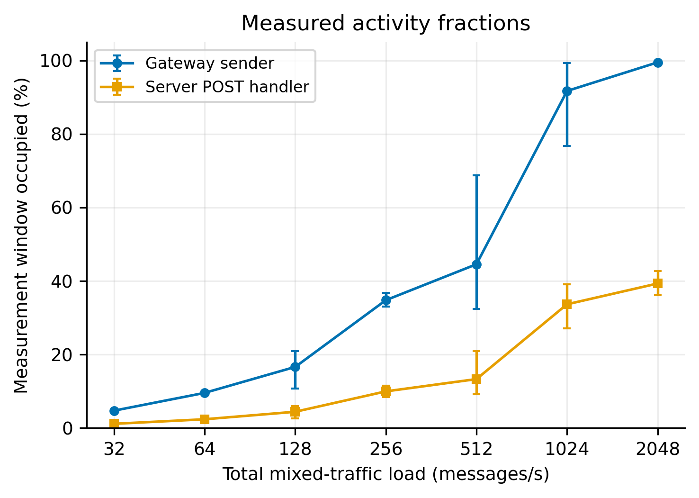

# Which figures to include

Every PDF, PNG and SVG now contains one plot. There are six main plots and five appendix plots; the previous multi-panel versions are archived in `figures/archive_combined/`. Use vector PDFs in Overleaf or the supplied 300-dpi PNGs elsewhere.

Include the six main plots below as space permits, together with the small latency/throughput table. The completed measurements and error-bar calculations are unchanged.

## Figure 1 - Successful-message latency

[PDF](figures/fig1_latency.pdf) | [PNG](figures/fig1_latency.png) | [SVG](figures/fig1_latency.svg)

**Caption:** Per-class p95 source-to-response latency for a FIFO HTTP/1.1 gateway. The bottom axis is robot-equivalent load N; the top axis is nominal total mixed traffic, 32N messages/s, across all four classes. Each coloured curve reports one class under the same mixed workload. At N=1, command, status, odometry and sensor rates are 2, 5, 20 and 5 messages/s; all rates scale by N. Latency includes successful messages only. Points are means of three run-level statistics; error bars show minimum-maximum. Load and latency use logarithmic scales.

**Use it to support:** Supports the scaling result; read alongside deadline failures and drops.

## Figure 2 - Deadline failures

[PDF](figures/fig2_deadlines.pdf) | [PNG](figures/fig2_deadlines.png) | [SVG](figures/fig2_deadlines.svg)

**Caption:** Per-class deadline-failure ratios, including late and unsuccessful messages. The bottom axis is robot-equivalent load N; the top axis is nominal total mixed traffic, 32N messages/s, across all four classes. Each coloured curve reports one class under the same mixed workload. At N=1, command, status, odometry and sensor rates are 2, 5, 20 and 5 messages/s; all rates scale by N. Targets are command 100 ms, status 200 ms, odometry 100 ms and sensor 1,000 ms. Points are means of three run-level statistics; error bars show minimum-maximum. Load uses a logarithmic scale.

**Use it to support:** Shows whether each class meets its target. Account for different target values when comparing classes.

## Figure 3 - Queue occupancy

[PDF](figures/fig3_queue.pdf) | [PNG](figures/fig3_queue.png) | [SVG](figures/fig3_queue.svg)

**Caption:** Time-averaged FIFO occupancy versus total mixed-traffic load across all four classes. The waiting queue holds 1,000 messages and excludes the in-service request. Points are means of three run-level statistics; error bars show minimum-maximum. Load and mean occupancy use logarithmic scales.

**Use it to support:** Shows queue accumulation and the bounded capacity under overload.

## Figure 4 - Completed throughput

[PDF](figures/fig4_throughput.pdf) | [PNG](figures/fig4_throughput.png) | [SVG](figures/fig4_throughput.svg)

**Caption:** Completed request throughput versus total mixed-traffic load across all four classes. The reference line denotes completed throughput equal to offered load. Points are means of three run-level statistics; error bars show minimum-maximum. Load uses a logarithmic scale.

**Use it to support:** Shows where completions fall behind the offered traffic.

## Figure 5 - Process CPU consumption

[PDF](figures/fig5_cpu.pdf) | [PNG](figures/fig5_cpu.png) | [SVG](figures/fig5_cpu.svg)

**Caption:** Process CPU consumption versus total mixed-traffic load across all four classes. CPU use is normalised to one logical CPU, so multithreaded processes can exceed 100%. Points are means of three run-level statistics; error bars show minimum-maximum. 

**Use it to support:** Compares source, gateway and server CPU demand; CPU use differs from occupied wall time.

## Figure 6 - Sender and server activity

[PDF](figures/fig6_busy_time.pdf) | [PNG](figures/fig6_busy_time.png) | [SVG](figures/fig6_busy_time.svg)

**Caption:** Gateway-sender and server-handler occupied fractions versus total mixed-traffic load. Sender activity covers dequeue to response completion; handler activity covers POST-handler entry to response write completion. Points are means of three run-level statistics; error bars show minimum-maximum. 

**Use it to support:** Supports the bottleneck interpretation. These measures are not inferred M/M/1 utilisation parameters.

## Optional appendix plots

### Application payload goodput

[PDF](figures/appendix_goodput.pdf) | [PNG](figures/appendix_goodput.png) | [SVG](figures/appendix_goodput.svg)

**Caption:** Delivered application payload goodput versus total mixed-traffic load. The dashed line shows nominal offered payload rate. Points are means of three run-level statistics; error bars show minimum-maximum. 

### FIFO drops

[PDF](figures/appendix_drops.pdf) | [PNG](figures/appendix_drops.png) | [SVG](figures/appendix_drops.svg)

**Caption:** The fraction of generated messages dropped at FIFO admission versus total mixed-traffic load. Points are means of three run-level statistics; error bars show minimum-maximum. Unlike the pooled summary-table percentage, each point averages run-level fractions.

### Queue traces

[PDF](figures/appendix_queue_trace.pdf) | [PNG](figures/appendix_queue_trace.png) | [SVG](figures/appendix_queue_trace.svg)

**Caption:** Waiting-queue occupancy sampled every 100 ms during repeat 1 of the three highest load conditions. This is a fixed repeat selection, not a best-run selection.

### CPU variation within a run

[PDF](figures/appendix_within_run_cpu.pdf) | [PNG](figures/appendix_within_run_cpu.png) | [SVG](figures/appendix_within_run_cpu.svg)

**Caption:** Process CPU consumption in consecutive 10-second bins of the first 32-equivalent repetition. CPU is normalised to one logical CPU; lines connect bin averages, not instantaneous samples.

### Queue variation within a run

[PDF](figures/appendix_within_run_queue.pdf) | [PNG](figures/appendix_within_run_queue.png) | [SVG](figures/appendix_within_run_queue.svg)

**Caption:** Time-averaged waiting-queue occupancy in consecutive 10-second bins of the first 32-equivalent repetition. The dashed line marks the 1,000-message capacity.

`individual_runs.csv` lists all 21 run-level results. `variability_note.md` explains the large high-load spread and the within-run CPU/queue changes without assuming a cause.

The five-minute packet capture supplies separate protocol/overhead evidence. Do not mix the old `results/baseline_formal/baseline.png` into the completed dataset: its workload implementation and instrumentation differ.
