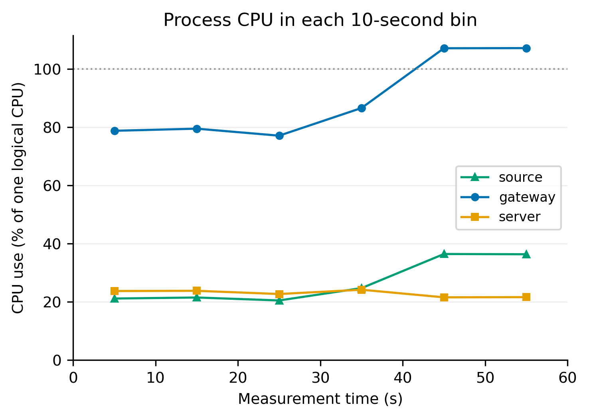
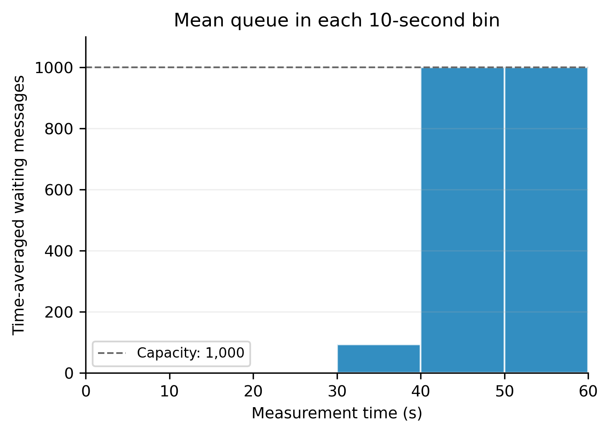

# E1 variability appendix

This appendix is an offline analysis of the existing formal dataset. No new performance runs were made.

The within-run figures use `n032_r01_708d8a8c`: 32 robot-equivalents, repeat 1. This fixed selection makes the change during that run visible; it is not presented as representative of every repetition.



**CPU caption:** Process CPU consumption in consecutive 10-second measurement bins of the 32-equivalent, repeat-1 run. CPU is normalised to one logical CPU and can exceed 100% for a multithreaded process. Cumulative CPU counters are interpolated at bin boundaries. Lines connect bin averages, not instantaneous CPU samples.



**Queue caption:** Time-averaged waiting-queue occupancy in consecutive 10-second measurement bins of the same 32-equivalent, repeat-1 run. Queue-state intervals are clipped and integrated at bin boundaries. The dashed line marks the 1,000-message waiting-queue capacity.

| Interval (s) | Source CPU % | Gateway CPU % | Server CPU % | Mean waiting queue |
|---:|---:|---:|---:|---:|
| 0-10 | 21.1 | 78.8 | 23.7 | 0.95 |
| 10-20 | 21.5 | 79.5 | 23.8 | 1.25 |
| 20-30 | 20.5 | 77.1 | 22.7 | 1.34 |
| 30-40 | 24.7 | 86.6 | 24.2 | 92.82 |
| 40-50 | 36.4 | 107.2 | 21.6 | 999.62 |
| 50-60 | 36.4 | 107.2 | 21.6 | 999.63 |

**Report-ready observation:** In the 32-equivalent, repeat-1 run, process CPU consumption and queue occupancy changed during the measurement window despite a constant configured offered load. The later part of the run consumed more source and gateway CPU time and accumulated a large waiting queue. This demonstrates that a single whole-run average hides a change in behaviour. These logs do not establish the cause; they cannot distinguish host conditions, scheduling, runtime effects or other implementation effects.

## Spread across all 64-equivalent repetitions

| Repeat | Offered/s | Completed/s | p95 latency (ms) | FIFO drops % | Mean waiting queue |
|---:|---:|---:|---:|---:|---:|
| 1 | 2048.00 | 139.12 | 7649.29 | 93.21 | 999.93 |
| 2 | 2047.73 | 194.23 | 5568.99 | 90.51 | 999.89 |
| 3 | 2048.00 | 1309.05 | 851.40 | 36.08 | 999.26 |

All three stress repetitions are included. Repeat numbers identify seeded repetitions; the sweep order was shuffled, so they are not chronological. p95 latency includes successful messages generated in the measurement window, including bounded-drain completions. Throughput counts completions inside the window, and the FIFO-drop denominator is generated messages in that window. All three runs experienced overflow, but their performance differs substantially. Report the range alongside the mean and avoid presenting the mean as a stable service-capacity estimate.

## Reproduce and verify

From the project root:

```bash
python experiments/variability_e1.py results/e1_complete
```

Inputs are the selected run's `config.json`, `cpu.csv` and `queue.csv`, the formal run summaries, and `validation.json`. The script checks that its time-weighted bin averages recover the validated whole-window CPU and queue statistics within 1e-7. It changes only this note and its own appendix CSV/PNG/PDF/SVG outputs.

Selected run configuration SHA-256: `de2c5975d066f7e763f41ad6fa4e520fb63571ef4c66d21419fc4f8d11653ce5`.

[Bin values (CSV)](figures/appendix_within_run_variability.csv) | [CPU PDF](figures/appendix_within_run_cpu.pdf) | [CPU SVG](figures/appendix_within_run_cpu.svg) | [Queue PDF](figures/appendix_within_run_queue.pdf) | [Queue SVG](figures/appendix_within_run_queue.svg)
