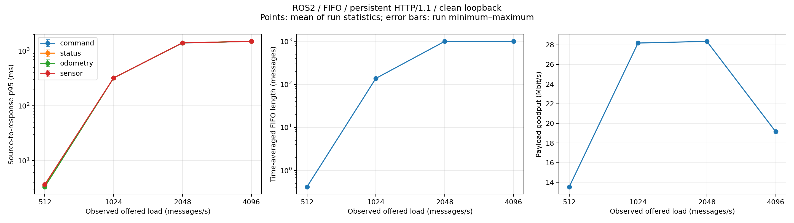
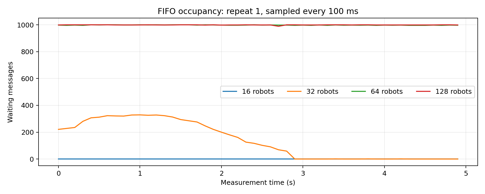

# Baseline experiment results

Actual ROS2 Humble publishers and subscriber in Ubuntu 22.04 WSL2, with a separate local HTTP server. One shared bounded FIFO, one sender, one outstanding HTTP request, no application retries or injected network faults.

Each condition has a 5-second warm-up, 60-second measurement window (unless overridden in saved config), and up to 15 seconds to drain. Load order is seeded and shuffled. Publishers use seeded independent periodic phases. All clocks are the same Linux host's monotonic clock.

| Robots | Runs | Offered msg/s | Completed msg/s | p95 ms, mean [min–max] | Mean FIFO length | Goodput Mbit/s | Drops | ROS missing |
|---:|---:|---:|---:|---:|---:|---:|---:|---:|
| 16 | 1 | 512.0 | 512.0 | 3.46 [3.46–3.46] | 0.417 | 13.530 | 0 | 0 |
| 32 | 1 | 1024.0 | 1068.0 | 322.07 [322.07–322.07] | 137.956 | 28.179 | 0 | 0 |
| 64 | 1 | 2048.0 | 1084.2 | 1411.15 [1411.15–1411.15] | 998.693 | 28.348 | 4821 | 0 |
| 128 | 1 | 4096.4 | 700.6 | 1499.39 [1499.39–1499.39] | 999.639 | 19.145 | 16978 | 0 |

## Per-class latency

Mean of each run's source-to-response p95, in milliseconds. Successful messages only.

| Robots | Command | Status | Odometry | Sensor |
|---:|---:|---:|---:|---:|
| 16 | 3.57 | 3.55 | 3.31 | 3.64 |
| 32 | 321.62 | 321.78 | 322.04 | 322.44 |
| 64 | 1402.42 | 1409.21 | 1411.18 | 1411.63 |
| 128 | 1499.24 | 1500.42 | 1499.12 | 1499.23 |

## Delay components and delivery

Mean delays across runs, in milliseconds. Delivery includes the drain period; drops are summed across repeats.

| Robots | ROS to gateway | FIFO wait | HTTP exchange | Successful/generated | FIFO drop fraction |
|---:|---:|---:|---:|---:|---:|
| 16 | 0.610 | 0.819 | 0.694 | 2560/2560 | 0.00% |
| 32 | 0.548 | 129.716 | 0.721 | 5120/5120 | 0.00% |
| 64 | 0.475 | 872.088 | 0.773 | 5419/10240 | 47.08% |
| 128 | 0.536 | 1261.584 | 1.114 | 3504/20482 | 82.89% |

## Definitions and limitations

- Latency: source publication timestamp to complete HTTP response receipt. Queue wait: gateway enqueue to dequeue. HTTP time includes JSON serialization and the exchange. Source-to-gateway delay includes ROS transport and callback scheduling.
- Latency statistics use successfully completed messages generated during the measurement window, including those completed during drain. Throughput counts completions inside the measurement window, so the populations intentionally differ.
- FIFO length is integrated over enqueue/dequeue events, excludes the request in service, and is bounded at 1,000 messages. Overflow drops the arriving message. ROS additionally uses reliable KEEP_LAST depth 1,000.
- Payload goodput counts only configured payload bytes, excluding JSON metadata, HTTP, TCP/IP and ROS overhead. The payload is repeated ASCII bytes; no compression is enabled.
- Each robot contributes 32 messages/s and nominally 0.8456 Mbit/s of application payload. These are synthetic robot identities/topics carried through one source process; they are not separate physical computers.
- This is a local WSL2 architecture baseline, not physical-link capacity or a real robot benchmark. Publisher, gateway and server share host CPU. There is no artificial server processing delay.
- The plots report means of per-run statistics with min–max ranges; these are not confidence intervals or pooled percentiles. Three repeats and approximately 120 command samples per robot per run limit p99 precision.
- No M/M/1 fit is claimed. Periodic mixed-size arrivals and measured HTTP service times do not establish its assumptions.
- Missing ROS messages, overflow drops, failed requests and pending messages must be considered alongside successful-message latency.

## Validation

All 4 completed runs passed identity uniqueness, source/gateway/server matching checks, timestamp ordering, HTTP/1.1 verification and exactly one accepted HTTP connection per run.
Total request errors: 0. Pending after drain: 0.
